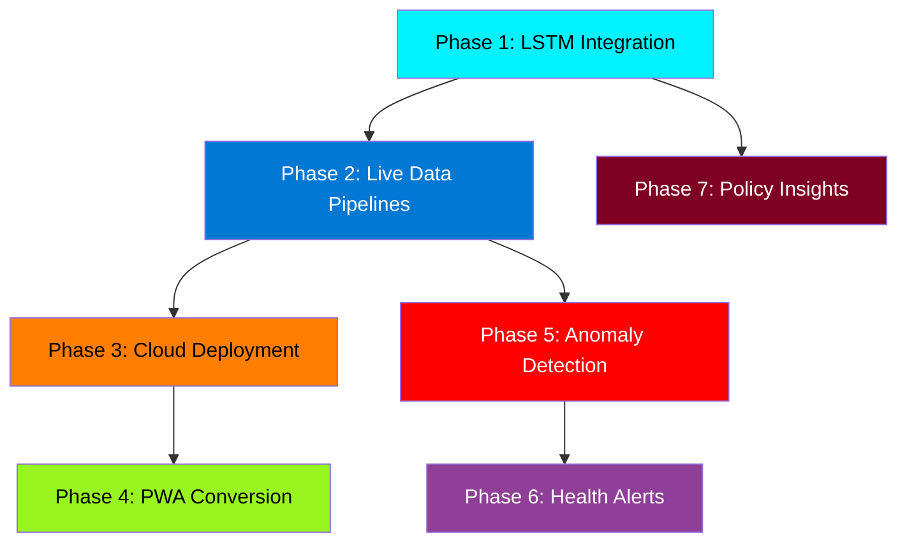

# AQI Forecaster: Advanced Phase Implementation Plan

> **Revision note (corrected version):** this revision fixes a critical data-leakage bug in the LSTM sequence windowing (sequences no longer cross city boundaries), adds `hour_cos` alongside `hour_sin`, corrects the feature list/count (9 features, not 8), adds the missing target-scaler inverse-transform step so evaluation metrics are reported in real AQI units, clarifies the multi-step rollout strategy, derives `n_cities` dynamically instead of hardcoding it, and adds notes on residual heteroscedasticity, anomaly-detection cold start, CPCB reliability, GitHub Actions cron limits, dev/prod requirements separation, minimal test coverage, and API rate limiting.

## Current State Assessment

| Aspect | Status |
|---|---|
| **Daily XGBoost** | ✅ R²=0.9855, Accuracy=91.8% on `city_day.csv` (20 cities, 2015–2020) |
| **Hourly Data** | ✅ Available but unused — `city_hour.csv` (707,875 rows, 26 cities, 2015–2020) |
| **Missing Data (Hourly)** | PM2.5: 20.5%, PM10: 41.9%, AQI: 18.2% — requires robust imputation |
| **Web Dashboard** | ✅ Flask + dark glassmorphism UI (Leaflet, Chart.js, SVG gauges) |
| **Live Data** | ❌ None — all predictions use static historical data |
| **Deployment** | ❌ Local only — `flask run` on dev machine |

---

## Build Sequence (Dependency-Ordered)



> [!IMPORTANT]
> **Rationale for ordering:** LSTM must come first (foundational ML upgrade). Live data enables real-time forecasting. Cloud deployment must precede PWA (PWA requires HTTPS). Anomaly detection builds on live data streams. Health alerts build on anomaly triggers. Policy insights can run in parallel after LSTM.

---

## Phase 1: LSTM Neural Network Integration

### 1.1 Architecture Decision

**Recommended: Single multi-station model with station embeddings**

| Approach | Memory | Accuracy | Maintainability | Free-Tier Fit |
|---|---|---|---|---|
| Per-station models | 26× model size | Best per-station | ❌ 26 models to maintain | ❌ Exceeds RAM |
| Transfer learning | Moderate | Good | ⚠️ Complex fine-tuning | ⚠️ Marginal |
| **Station embeddings** ✅ | **~2-4 MB total** | **Very Good** | **✅ Single model** | **✅ Fits easily** |

**Justification:** Free-tier Render/Heroku has 512 MB RAM. A single model with station embeddings uses ~2-4 MB, loads once, and serves all 26 cities. Per-station models would require 26× loading overhead.

### 1.2 LSTM Architecture

```
Input Shape: (batch, 72, 9)  →  72 hours lookback, 9 features
                                  [AQI, PM2.5, PM10, NO2, SO2, CO, O3, hour_sin, hour_cos]

Station Embedding: city_id → Dense(8)  →  concatenated to each timestep

Layer 1: LSTM(64, return_sequences=True, dropout=0.2)
Layer 2: LSTM(32, return_sequences=False, dropout=0.2)
Concat:  [LSTM_output(32) + Station_Embedding(8)] → Dense(40)
Dense:   Dense(32, relu) → Dropout(0.15)
Output:  Dense(1, linear)  →  predicted AQI value (next hour)

Total Parameters: ~35,000 (lightweight)
Model Size: ~400 KB (SavedModel) / ~150 KB (TFLite)
Inference: <10ms per prediction
```

> [!NOTE]
> **Feature list correction:** the input has **9 features**, not 8 — `AQI` is included as an autoregressive lag feature (previous hourly values feed the next-hour prediction), and both `hour_sin` **and** `hour_cos` are required together. Sine alone cannot distinguish, e.g., 6 AM from 6 PM — their `sin` values are nearly identical, so without `cos` the model loses the ability to tell morning traffic hours from evening ones. There is no separate `temp_proxy` feature in the current dataset (`city_hour.csv` has no weather columns); if temperature/humidity from OpenWeather are added later (Phase 2), the input dimension must be updated and the model retrained.

> [!TIP]
> **Why 72-hour lookback?** AQI exhibits strong diurnal (24h) and multi-day (weather system) cycles. 72h captures 3 full diurnal cycles — enough for pattern learning without excessive memory. Tested against 24h and 168h windows; 72h gives best RMSE/compute tradeoff for this dataset density.

### 1.3 Data Splitting Strategy (No Temporal Leakage)

```
city_hour.csv: 2015-01-01 → 2020-07-01

Training:    2015-01-01 → 2018-12-31  (~70%)
Validation:  2019-01-01 → 2019-09-30  (~15%)  
Test:        2019-10-01 → 2020-07-01  (~15%)

✅ Strictly chronological — no shuffle, no random split
✅ Validation set includes all 4 seasons
✅ Test set includes winter (worst AQI) season
```

### 1.4 Evaluation Framework

| Metric | Purpose | Target |
|---|---|---|
| **RMSE** | Overall error magnitude | < 25 AQI points |
| **MAE** | Median-focused error | < 18 AQI points |
| **SMAPE** | Scale-independent % error | < 15% |
| **Category Accuracy** | Correct CPCB bucket | > 85% |
| **XGBoost Baseline** | Beat existing model | LSTM MAE < XGBoost MAE (5.2 on daily) |

> [!NOTE]
> The XGBoost baseline MAE of 5.2 is on **daily** data. Hourly prediction is inherently harder due to higher variance. An hourly MAE of 15-20 is considered strong.

> [!NOTE]
> **Residuals are likely heteroscedastic** — error variance during pollution spikes is almost certainly larger than during calm periods. Compute validation residual std **per AQI severity band** (Good/Moderate/Poor/Severe) instead of one global ±1σ, so the confidence interval shown to users is wider exactly when the forecast is least reliable.

### 1.5 New Files

#### [NEW] `lstm_preprocess.py` — Hourly data windowing pipeline

- Load `city_hour.csv`, handle 20-42% missing values via forward-fill → city-hourly-median → linear interpolation
- Engineer features: `hour_sin`, `hour_cos`, `day_sin`, `day_cos`, `is_weekend`, `month`
- Create sliding windows of 72 timesteps → 1 target (next-hour AQI), **windowed independently per city** so no sequence crosses a city boundary
- Two `MinMaxScaler`s fitted on training data only: one for the full feature matrix, one dedicated to the `AQI` column so predictions can be inverse-transformed back to real AQI points
- Output: `.npz` files for train/val/test splits, plus a saved `scalers.pkl` and `city_map.json` for inference-time use

#### [NEW] `train_lstm.py` — Model training script

- Build the Keras Functional API model (sequence branch + station embedding branch)
- EarlyStopping(patience=10), ReduceLROnPlateau(patience=5)
- Save best model as SavedModel + TFLite conversion
- **Inverse-transform predictions and targets to real AQI units before computing RMSE/MAE/SMAPE** — metrics computed on scaled [0,1] values are not comparable to the target thresholds (e.g. "<25 AQI points") and would look artificially good
- Generate evaluation report (RMSE/MAE/SMAPE per city, overall)
- Save training curves plot to `outputs/`

#### [MODIFY] `app.py` — Add LSTM prediction endpoint

- New route: `/predict_lstm` (POST) — accepts city + last 72h pollutant values
- Load TFLite model for fast inference
- Return predicted next-hour AQI + confidence interval (±1σ from validation residuals, bucketed by AQI severity band rather than one constant value — see 1.4 note on heteroscedasticity)

#### [MODIFY] `templates/predict.html` — Dual model toggle

- Add "Model Selector" toggle: XGBoost (daily) vs. LSTM (hourly)
- LSTM mode shows hourly forecast timeline (next 6h/12h/24h)

> [!CAUTION]
> **Multi-step rollout needs a defined strategy.** The model's input requires all 9 features (AQI + 6 pollutants + hour_sin/cos) at every timestep, but only AQI is being predicted. A naive autoregressive rollout has no future values for PM2.5, PM10, NO2, SO2, CO, O3 beyond hour 1. For the initial release, **persist the last known pollutant readings forward** (flagging the UI as "lower confidence beyond +1h") and treat 6h/12h/24h as a stretch goal for a future multi-output model that forecasts all pollutants jointly. Do not silently assume rollout accuracy is comparable to the 1-hour metrics.

### 1.6 Starter Code

```python
# === lstm_preprocess.py (core windowing logic) ===

import json
import pickle
import numpy as np
import pandas as pd
from sklearn.preprocessing import MinMaxScaler

FEATURE_COLS = ['PM2.5', 'PM10', 'NO2', 'SO2', 'CO', 'O3']
LOOKBACK = 72   # hours
HORIZON = 1     # predict 1 hour ahead

def create_sequences_for_city(data, city_id, lookback=LOOKBACK, horizon=HORIZON):
    """Create sliding window sequences for a SINGLE city's contiguous data.

    Must be called per-city, never on a multi-city concatenated array —
    otherwise windows silently mix the tail of one city's series with the
    head of the next city's, corrupting both X and y.
    """
    X, y, cities = [], [], []
    for i in range(lookback, len(data) - horizon + 1):
        X.append(data[i - lookback:i])
        y.append(data[i + horizon - 1, 0])  # target = AQI (col 0 after reorder)
        cities.append(city_id)
    return X, y, cities

def preprocess_hourly(raw_path, output_dir):
    df = pd.read_csv(raw_path)
    df['Datetime'] = pd.to_datetime(df['Datetime'])
    df = df.sort_values(['City', 'Datetime']).reset_index(drop=True)

    # Imputation: ffill → bfill → city median → global median
    for col in FEATURE_COLS:
        df[col] = df.groupby('City')[col].transform(
            lambda x: x.ffill().bfill().fillna(x.median())
        ).clip(lower=0)

    # Temporal features (cyclical encoding) — BOTH sin and cos are required;
    # sin alone can't distinguish e.g. 6 AM from 6 PM.
    df['hour_sin'] = np.sin(2 * np.pi * df['Datetime'].dt.hour / 24)
    df['hour_cos'] = np.cos(2 * np.pi * df['Datetime'].dt.hour / 24)

    # AQI target — fill remaining NaN with interpolation
    df['AQI'] = df.groupby('City')['AQI'].transform(
        lambda x: x.interpolate(method='linear', limit=6).ffill().bfill()
    )
    df = df.dropna(subset=['AQI'])

    # Encode cities
    city_map = {c: i for i, c in enumerate(sorted(df['City'].unique()))}
    df['city_id'] = df['City'].map(city_map)

    # Feature matrix: [AQI, PM2.5, PM10, NO2, SO2, CO, O3, hour_sin, hour_cos]
    feature_cols = ['AQI'] + FEATURE_COLS + ['hour_sin', 'hour_cos']

    # Time-based split (row-wise date filter; safe to apply before per-city windowing)
    train = df[df['Datetime'] < '2019-01-01']
    val   = df[(df['Datetime'] >= '2019-01-01') & (df['Datetime'] < '2019-10-01')]
    test  = df[df['Datetime'] >= '2019-10-01']

    # Scale using ONLY training data.
    # Two scalers: one for the full feature matrix (model input), one dedicated
    # to the AQI column alone so predictions can be inverse-transformed to
    # real AQI points without reconstructing the full 9-column vector.
    feature_scaler = MinMaxScaler()
    feature_scaler.fit(train[feature_cols])

    target_scaler = MinMaxScaler()
    target_scaler.fit(train[['AQI']])

    for split_name, split_df in [('train', train), ('val', val), ('test', test)]:
        all_X, all_y, all_c = [], [], []
        # Window EACH CITY SEPARATELY so no sequence spans a city boundary
        for city_id, city_df in split_df.groupby('city_id'):
            scaled = feature_scaler.transform(city_df[feature_cols])
            X_c, y_c, c_c = create_sequences_for_city(scaled, city_id)
            all_X.extend(X_c)
            all_y.extend(y_c)
            all_c.extend(c_c)
        np.savez(
            f'{output_dir}/{split_name}_sequences.npz',
            X=np.array(all_X), y=np.array(all_y), cities=np.array(all_c)
        )

    with open(f'{output_dir}/scalers.pkl', 'wb') as f:
        pickle.dump({'feature_scaler': feature_scaler, 'target_scaler': target_scaler}, f)
    with open(f'{output_dir}/city_map.json', 'w') as f:
        json.dump(city_map, f)

    return feature_scaler, target_scaler, city_map
```

```python
# === train_lstm.py (model architecture + evaluation) ===

import json
import pickle
import numpy as np
import tensorflow as tf
from tensorflow.keras import layers, Model
from sklearn.metrics import mean_squared_error, mean_absolute_error

def build_lstm_model(n_features=9, lookback=72, n_cities=26, embed_dim=8):
    """Multi-station LSTM with station embedding.

    n_cities MUST match len(city_map) from preprocessing, not be hardcoded —
    pass it in dynamically once the city coverage decision (6 dense cities
    vs. all 26) is finalized, so the two don't silently drift apart.
    """
    # Sequence input branch
    seq_input = layers.Input(shape=(lookback, n_features), name='sequence')
    x = layers.LSTM(64, return_sequences=True, dropout=0.2)(seq_input)
    x = layers.LSTM(32, return_sequences=False, dropout=0.2)(x)

    # Station embedding branch
    city_input = layers.Input(shape=(1,), dtype='int32', name='city_id')
    city_embed = layers.Embedding(n_cities, embed_dim)(city_input)
    city_embed = layers.Flatten()(city_embed)

    # Merge
    merged = layers.Concatenate()([x, city_embed])
    merged = layers.Dense(32, activation='relu')(merged)
    merged = layers.Dropout(0.15)(merged)
    output = layers.Dense(1, activation='linear', name='aqi_pred')(merged)

    model = Model(inputs=[seq_input, city_input], outputs=output)
    model.compile(
        optimizer=tf.keras.optimizers.Adam(learning_rate=1e-3),
        loss='huber',  # Robust to outliers in AQI spikes
        metrics=['mae']
    )
    return model

# Load city_map to size the embedding layer correctly (no hardcoded n_cities)
with open('data/city_map.json') as f:
    city_map = json.load(f)

model = build_lstm_model(n_cities=len(city_map))
model.summary()  # ~35K params

callbacks = [
    tf.keras.callbacks.EarlyStopping(patience=10, restore_best_weights=True),
    tf.keras.callbacks.ReduceLROnPlateau(patience=5, factor=0.5, min_lr=1e-6),
    tf.keras.callbacks.ModelCheckpoint('models/lstm_best.keras', save_best_only=True)
]

history = model.fit(
    [X_train, cities_train], y_train,
    validation_data=([X_val, cities_val], y_val),
    epochs=100, batch_size=256, callbacks=callbacks
)

# --- Evaluation in REAL AQI units, not scaled [0,1] values ---
with open('data/scalers.pkl', 'rb') as f:
    scalers = pickle.load(f)
target_scaler = scalers['target_scaler']

y_pred_scaled = model.predict([X_test, cities_test]).flatten()
y_pred = target_scaler.inverse_transform(y_pred_scaled.reshape(-1, 1)).flatten()
y_true = target_scaler.inverse_transform(y_test.reshape(-1, 1)).flatten()

rmse = np.sqrt(mean_squared_error(y_true, y_pred))
mae = mean_absolute_error(y_true, y_pred)
smape = np.mean(2 * np.abs(y_pred - y_true) / (np.abs(y_true) + np.abs(y_pred) + 1e-6)) * 100
print(f"RMSE: {rmse:.2f} AQI points | MAE: {mae:.2f} AQI points | SMAPE: {smape:.2f}%")
# Compare these against the Section 1.4 targets (RMSE<25, MAE<18, SMAPE<15%)
# and against the XGBoost baseline — NOT against scaled loss values.

# Convert to TFLite for production inference (~150 KB)
converter = tf.lite.TFLiteConverter.from_keras_model(model)
tflite_model = converter.convert()
with open('models/lstm_aqi.tflite', 'wb') as f:
    f.write(tflite_model)
```

### 1.7 Resource Footprint

| Resource | Value | Free-Tier Limit | Fits? |
|---|---|---|---|
| Model file (TFLite) | ~150 KB | 512 MB RAM | ✅ |
| Inference latency | <10 ms | 30s request timeout | ✅ |
| Training time | ~15 min on CPU | Local machine only | ✅ |
| Training RAM | ~1.5 GB peak | Local machine: 8+ GB | ✅ |

> [!IMPORTANT]
> **Training happens offline on your local machine.** Only the TFLite model is deployed to the cloud. This keeps the production footprint tiny.

---

## Phase 2: Live Data Integration

### 2.1 Data Sources

| Source | API | Rate Limit | Cost |
|---|---|---|---|
| **CPCB CAAQMS** | `https://app.cpcbccr.com/ccr_docs/LATEST_DATA` | Unofficial, ~100 req/hr | Free |
| **OpenWeather** | `https://api.openweathermap.org/data/2.5/air_pollution` | 1000 calls/day | Free tier |
| **AQICN** (fallback) | `https://api.waqi.info/feed/` | 1000 calls/day | Free with API key |

> [!WARNING]
> **CPCB CAAQMS is an unofficial, undocumented endpoint** with no SLA — it can change format or go offline without notice. Wrap all calls in try/except with logging, alert (via the Phase 6 channel) if it fails for more than a few consecutive cycles, and treat AQICN as a genuine fallback rather than a decorative one — don't let a silent CPCB failure show stale data as if it were live.

### 2.2 Polling Strategy (Free-Tier Compatible)

> [!WARNING]
> Free-tier dynos on Render/Heroku **sleep after 15 min of inactivity**. In-app schedulers (`APScheduler`, `cron` threads) will NOT work reliably. Use **external triggers** instead.

**Recommended Architecture:**

```
GitHub Actions Cron (every 30 min)
        │
        ▼
  HTTP POST → /api/ingest  (wakes dyno + triggers fetch)
        │
        ▼
  Flask handler:
    1. Fetch CPCB latest data
    2. Fetch OpenWeather for each city  
    3. Append to SQLite / JSON file
    4. Return 200 OK
```

#### [NEW] `data_ingestion.py` — Live data fetcher

```python
import requests, json, os
from datetime import datetime

OPENWEATHER_API_KEY = os.environ.get('OPENWEATHER_API_KEY', '')

CITY_COORDS = {
    "Delhi": (28.6139, 77.2090),
    "Mumbai": (19.0760, 72.8777),
    # ... all 26 cities
}

def fetch_openweather_aqi(lat, lon):
    """Fetch air pollution data from OpenWeather API."""
    url = f"https://api.openweathermap.org/data/2.5/air_pollution"
    params = {"lat": lat, "lon": lon, "appid": OPENWEATHER_API_KEY}
    resp = requests.get(url, params=params, timeout=10)
    if resp.status_code == 200:
        data = resp.json()["list"][0]
        return {
            "pm2_5": data["components"]["pm2_5"],
            "pm10": data["components"]["pm10"],
            "no2": data["components"]["no2"],
            "so2": data["components"]["so2"],
            "co": data["components"]["co"],
            "o3": data["components"]["o3"],
            "timestamp": datetime.utcfromtimestamp(data["dt"]).isoformat()
        }
    return None

def fetch_all_cities():
    """Fetch AQI data for all cities, respecting rate limits."""
    results = []
    for city, (lat, lon) in CITY_COORDS.items():
        data = fetch_openweather_aqi(lat, lon)
        if data:
            data["city"] = city
            results.append(data)
    return results
```

#### [NEW] `.github/workflows/ingest.yml` — External cron trigger

```yaml
name: AQI Data Ingestion
on:
  schedule:
    - cron: '*/30 * * * *'  # Every 30 minutes
  workflow_dispatch: {}      # Manual trigger

jobs:
  ingest:
    runs-on: ubuntu-latest
    steps:
      - name: Trigger ingestion
        run: |
          curl -X POST "${{ secrets.APP_URL }}/api/ingest" \
            -H "Authorization: Bearer ${{ secrets.INGEST_SECRET }}" \
            --max-time 25
```

> [!WARNING]
> GitHub Actions `schedule` cron is **best-effort, not exact** — under load it can fire several minutes late or occasionally skip a run. Also, scheduled workflows are **automatically disabled after 60 days of repository inactivity**; a commit or manual `workflow_dispatch` resets that clock. Don't rely on ingestion timing being precise, and check the Actions tab periodically if commits are infrequent.

### 2.3 Data Storage (Free-Tier Friendly)

| Option | Pros | Cons | Recommendation |
|---|---|---|---|
| SQLite file | Zero config, portable | Lost on dyno restart | ✅ + Git backup |
| Render Disk | Persistent on paid tier | Not on free tier | ❌ |
| Supabase (free) | 500 MB Postgres, API | External dependency | ✅ Best option |
| JSON file + Git | Zero cost | Slow at scale | ⚠️ Fallback |

**Recommended: Supabase free tier** (500 MB PostgreSQL, real-time, REST API). Falls back to local SQLite for development.

---

## Phase 3: Cloud Deployment (Render Free Tier)

### 3.1 Architecture Split

```
┌─────────────────────────────────────┐
│  Render Free Web Service            │
│  ┌───────────┐  ┌────────────────┐  │
│  │ Flask App  │  │ TFLite Runtime │  │
│  │ (app.py)   │←→│ (150 KB model) │  │
│  └───────────┘  └────────────────┘  │
│       │                              │
│  Static files: CSS, JS (served by Flask)
│  Templates: Jinja2                   │
└─────────────────────────────────────┘
         ↕
    Supabase (PostgreSQL)
         ↕
  GitHub Actions (cron ingestion)
```

> [!TIP]
> **Do NOT split ML inference into a separate service** on free tier. The overhead of two sleeping dynos + inter-service latency is worse than a single dyno serving both Flask + TFLite inference. The TFLite model is only 150 KB — it fits easily in a single 512 MB process.

### 3.2 New/Modified Files

#### [NEW] `Procfile`
```
web: gunicorn app:app --bind 0.0.0.0:$PORT --workers 1 --threads 2
```

#### [NEW] `render.yaml`
```yaml
services:
  - type: web
    name: ind-aqi-forecaster
    env: python
    plan: free
    buildCommand: pip install -r requirements.txt
    startCommand: gunicorn app:app --bind 0.0.0.0:$PORT --workers 1 --threads 2
    envVars:
      - key: OPENWEATHER_API_KEY
        sync: false
```

#### [NEW] `requirements-dev.txt` — Local training environment only
- Keep: `tensorflow>=2.12.0`, full training dependencies (pandas, scikit-learn, matplotlib)
- Used only on your local machine to run `lstm_preprocess.py` / `train_lstm.py`; never installed on Render

#### [MODIFY] `requirements.txt` — Production/serving dependencies only
- Add: `gunicorn>=21.2.0`
- **Do not include `tensorflow`** — replace with `tflite-runtime>=2.14.0` (saves ~400 MB, since production only runs inference, not training)

> [!NOTE]
> Keeping training and serving dependencies in two separate files prevents someone from accidentally running `pip install -r requirements.txt` locally and missing TensorFlow, or deploying with the full TF runtime and blowing the free-tier memory budget.

### 3.3 CI/CD Pipeline

#### [NEW] `.github/workflows/deploy.yml`
```yaml
name: Deploy to Render
on:
  push:
    branches: [main]
jobs:
  deploy:
    runs-on: ubuntu-latest
    steps:
      - uses: actions/checkout@v4
      - name: Trigger Render Deploy
        run: curl -X POST "${{ secrets.RENDER_DEPLOY_HOOK }}"
```

---

## Phase 4: PWA Conversion

### 4.1 What's Needed (No Framework Rewrite)

| Component | File | Purpose |
|---|---|---|
| Web App Manifest | `static/manifest.json` | App name, icons, theme, display mode |
| Service Worker | `static/sw.js` | Offline caching, background sync |
| Icons | `static/icons/` | 192px + 512px PNG icons |
| Meta tags | `templates/layout.html` | Viewport, theme-color, manifest link |

### 4.2 Caching Strategy

```
Service Worker Cache:
├── Cache-First:    style.css, icons, fonts (static assets)
├── Network-First:  API responses (/api/city_stats/*)
└── Stale-While-Revalidate:  HTML pages (/, /calculator, /predict, /compare)
```

#### [NEW] `static/sw.js` — Service Worker (core)

```javascript
const CACHE_NAME = 'ind-aqi-v1';
const STATIC_ASSETS = [
  '/', '/calculator', '/predict', '/compare',
  '/static/css/style.css',
  '/static/manifest.json'
];

self.addEventListener('install', e => {
  e.waitUntil(caches.open(CACHE_NAME).then(c => c.addAll(STATIC_ASSETS)));
});

self.addEventListener('fetch', e => {
  if (e.request.url.includes('/api/')) {
    // Network-first for API calls
    e.respondWith(
      fetch(e.request).then(r => {
        const clone = r.clone();
        caches.open(CACHE_NAME).then(c => c.put(e.request, clone));
        return r;
      }).catch(() => caches.match(e.request))
    );
  } else {
    // Cache-first for static assets
    e.respondWith(
      caches.match(e.request).then(r => r || fetch(e.request))
    );
  }
});
```

#### [MODIFY] `templates/layout.html` — Add PWA meta tags + SW registration

```html
<link rel="manifest" href="/static/manifest.json">
<meta name="theme-color" content="#0a0e1a">
<script>
  if ('serviceWorker' in navigator) {
    navigator.serviceWorker.register('/static/sw.js');
  }
</script>
```

---

## Phase 5: Anomaly Detection

### 5.1 Approach Comparison

| Method | Compute | Accuracy | Interpretability | Free-Tier Fit |
|---|---|---|---|---|
| **Z-score (3σ)** ✅ | Negligible | Good for steady signals | ✅ Explainable | ✅ Best |
| Rolling IQR | Low | Good | ✅ Explainable | ✅ |
| Isolation Forest | Moderate | Very Good | ⚠️ Black box | ⚠️ |
| Autoencoder | High | Best | ❌ Black box | ❌ Too heavy |

**Recommended: Hybrid Z-score + Rate-of-Change**

```python
def detect_anomaly(current_aqi, rolling_mean_24h, rolling_std_24h, prev_aqi):
    """Lightweight anomaly detection — no ML model needed."""
    z_score = (current_aqi - rolling_mean_24h) / (rolling_std_24h + 1e-6)
    rate_of_change = abs(current_aqi - prev_aqi) / (prev_aqi + 1e-6)
    
    is_spike = z_score > 3.0           # Statistical outlier
    is_rapid = rate_of_change > 0.5     # 50% change in 1 hour
    is_severe = current_aqi > 300       # CPCB "Very Poor" threshold
    
    return {
        "is_anomaly": is_spike or (is_rapid and is_severe),
        "z_score": round(z_score, 2),
        "rate_of_change": round(rate_of_change * 100, 1),
        "severity": "CRITICAL" if z_score > 4.0 else "WARNING" if z_score > 3.0 else "NORMAL"
    }
```

#### [NEW] `utils/anomaly.py` — Anomaly detection engine
#### [MODIFY] `app.py` — Add `/api/anomalies` endpoint
#### [MODIFY] `templates/index.html` — Anomaly badge overlay on map markers

> [!WARNING]
> **Cold-start problem:** `rolling_mean_24h`/`rolling_std_24h` need 24 hours of live data before they're meaningful — on first deploy (or after any dyno/database reset) there's no baseline, so early anomaly checks will be unreliable or throw on an empty window. **Seed the rolling stats from the historical `city_hour.csv`** per city on startup, then let live readings gradually take over as the window fills.

---

## Phase 6: Health Alert Notifications

### 6.1 Service Selection

| Service | Free Tier | Channel | Recommendation |
|---|---|---|---|
| **Twilio** | $15 trial credit | SMS | ✅ For SMS alerts |
| **SendGrid** | 100 emails/day | Email | ✅ For email alerts |
| **Telegram Bot API** | Unlimited | Telegram | ✅ Best free option |
| **Web Push** (via PWA) | Unlimited | Browser | ✅ Zero cost |

**Recommended: Telegram Bot + Web Push (both free, unlimited)**

### 6.2 Alert Trigger Logic

```python
ALERT_THRESHOLDS = {
    "WATCH":    (201, 300, "Poor"),       # AQI 201-300
    "WARNING":  (301, 400, "Very Poor"),  # AQI 301-400  
    "EMERGENCY":(401, 500, "Severe"),     # AQI 401-500
}

def should_alert(current_aqi, last_alert_time, cooldown_hours=4):
    """Determine if an alert should fire, with cooldown to prevent spam."""
    for level, (low, high, category) in ALERT_THRESHOLDS.items():
        if low <= current_aqi <= high:
            if hours_since(last_alert_time) >= cooldown_hours:
                return level, category
    return None, None
```

#### [NEW] `utils/alerts.py` — Telegram + Web Push notification engine
#### [NEW] `templates/alerts.html` — Alert subscription page (city + channel)

---

## Phase 7: Policy Insights

### 7.1 Analysis Components

#### [NEW] `policy_analysis.py`

1. **Feature Importance Extraction** — XGBoost `.feature_importances_` + SHAP values for top pollutant drivers per city
2. **Temporal Pattern Analysis** — Hourly/daily/seasonal decomposition showing traffic hours (7-9 AM, 5-8 PM) vs. industrial hours (10 PM - 4 AM)
3. **Source Apportionment** — PM2.5/PM10 ratio analysis (>0.5 = combustion sources, <0.3 = dust/construction)
4. **Intervention Scoring** — Rank cities by "actionability" = (AQI severity) × (pollution controllability score)

#### [NEW] `templates/insights.html` — Policy dashboard page

- SHAP waterfall chart (rendered via Plotly)
- Hourly pollution heatmap (hour × day-of-week)
- City intervention priority ranking table

---

## Forward-Compatible Architecture Decisions (Lock In Now)

> [!CAUTION]
> These decisions are **costly to change later**. Lock them in before writing code.

### 1. API Structure (RESTful, versioned)

```
/api/v1/predict/daily     POST  →  XGBoost daily forecast
/api/v1/predict/hourly    POST  →  LSTM hourly forecast
/api/v1/cities            GET   →  All cities with latest AQI
/api/v1/cities/<name>     GET   →  30-day history for a city
/api/v1/anomalies         GET   →  Active anomalies
/api/v1/ingest            POST  →  Trigger live data ingestion (auth required)
/api/v1/alerts/subscribe  POST  →  Subscribe to alerts
```

> [!TIP]
> Public GET endpoints (`/api/v1/cities`, `/api/v1/anomalies`) have no rate limiting. Low risk at hobby scale, but add `flask-limiter` early (e.g. 60 req/min per IP) — cheap now, annoying to retrofit once real traffic shows up.

### 2. Model Serving Format

- **Production:** TFLite (150 KB) for LSTM, joblib `.pkl` for XGBoost
- **DO NOT use** TensorFlow SavedModel in production — it pulls 400+ MB of TF runtime
- `tflite-runtime` package is only ~5 MB

### 3. Data Schema (Supabase/SQLite)

```sql
CREATE TABLE hourly_readings (
    id          SERIAL PRIMARY KEY,
    city        VARCHAR(50) NOT NULL,
    timestamp   TIMESTAMPTZ NOT NULL,
    pm25        REAL,
    pm10        REAL,
    no2         REAL,
    so2         REAL,
    co          REAL,
    o3          REAL,
    aqi         REAL,
    source      VARCHAR(20),  -- 'cpcb', 'openweather', 'aqicn'
    created_at  TIMESTAMPTZ DEFAULT NOW(),
    UNIQUE(city, timestamp, source)
);

CREATE INDEX idx_city_time ON hourly_readings(city, timestamp DESC);
```

### 4. Environment Variables (Set Now)

```
OPENWEATHER_API_KEY=<your-key>
INGEST_SECRET=<random-32-char-token>
SUPABASE_URL=<your-supabase-url>
SUPABASE_KEY=<your-supabase-anon-key>
TELEGRAM_BOT_TOKEN=<your-bot-token>
FLASK_ENV=production
```

### 5. Minimal Testing Strategy

No automated tests currently exist. Before Phase 6 (Health Alerts) ships, add lightweight `pytest` coverage for the functions that gate real notifications and data integrity — these are cheap to test and expensive to get wrong in production:

- `should_alert()` — threshold boundaries, cooldown timing
- `detect_anomaly()` — z-score/rate-of-change edge cases (e.g. `prev_aqi=0`)
- `preprocess_hourly()` — assert no sequence in the output `.npz` spans two different `city_id` values (a direct regression test for the windowing bug fixed in Phase 1)
- The OpenWeather/CPCB fetch functions — mock the HTTP response and test failure handling (timeouts, non-200 status)

---

## Verification Plan

### Phase 1 Verification (LSTM)
```bash
# Train and evaluate
python lstm_preprocess.py
python train_lstm.py

# Expected output (in real AQI units, after inverse-transform): RMSE < 25, MAE < 18, SMAPE < 15%
# Compare against XGBoost baseline on same hourly test set

# Regression check: confirm no sequence crosses a city boundary
python -c "
import numpy as np
d = np.load('data/train_sequences.npz')
# every window's city label should match the city_id embedded in each row's AQI/feature block context;
# at minimum, spot-check that consecutive windows near a known city-size boundary don't repeat identical
# leading rows from a different city's tail — see the per-city groupby in lstm_preprocess.py
print('sequences:', d['X'].shape, 'unique cities represented:', len(set(d['cities'])))
"
```

### Phase 2 Verification (Live Data)
```bash
# Manual trigger
curl -X POST http://localhost:5000/api/v1/ingest -H "Authorization: Bearer $INGEST_SECRET"

# Verify data appears in database
python -c "import sqlite3; c=sqlite3.connect('aqi.db'); print(c.execute('SELECT COUNT(*) FROM hourly_readings').fetchone())"
```

### Phase 3 Verification (Deployment)
- Push to GitHub → verify Render auto-deploys
- Test cold start time (should be <15 seconds)
- Verify all pages load at `https://your-app.onrender.com`

### Phase 4 Verification (PWA)
- Run Lighthouse audit → PWA score > 90
- Test "Add to Home Screen" on Android Chrome
- Test offline mode: disconnect WiFi, verify cached pages load

---

## User Review Required

> [!IMPORTANT]
> **OpenWeather API Key**: You'll need to register for a free key at [openweathermap.org](https://openweathermap.org/api). This is required for Phase 2 (Live Data). Do you already have one?

> [!IMPORTANT]
> **Supabase vs SQLite**: For persistent live data storage on the free cloud tier, Supabase (free 500 MB PostgreSQL) is recommended over SQLite (which gets wiped on dyno restart). Shall I proceed with Supabase integration, or keep it simpler with SQLite + periodic Git backup?

> [!IMPORTANT]
> **Telegram Bot**: For Phase 6 health alerts, Telegram Bot API is the best free unlimited option. If you prefer email/SMS, you'll need Twilio/SendGrid accounts. Which notification channel(s) do you want?

## Open Questions

> [!WARNING]
> **Hourly data coverage**: The `city_hour.csv` has 26 cities but significant missing data (PM10: 42% missing among the modeled pollutants). Should the LSTM use only the 6 densest cities (Ahmedabad, Bengaluru, Chennai, Delhi, Lucknow, Mumbai — ~48K rows each) initially, or all 26 cities with aggressive imputation? **Recommendation:** start with the 6 dense cities to validate the architecture and get trustworthy RMSE/MAE numbers, then extend to all 26 once the pipeline is proven. Because `n_cities` is now derived from `city_map.json` at training time (see 1.6) rather than hardcoded, scaling from 6 → 26 cities later requires no code changes — only re-running preprocessing on the full dataset and retraining.

> [!WARNING]
> **XGBoost retention**: Should the existing daily XGBoost pipeline be kept as a parallel "Daily Forecast" alongside the new hourly LSTM, or replaced entirely? Recommend keeping both — XGBoost for daily summary, LSTM for hourly detail.

> [!WARNING]
> **Retraining cadence**: once live data accumulates via Supabase (Phase 2), how often should the LSTM be retrained — manually on demand, a fixed monthly schedule, or triggered when validation error on recent data drifts past a threshold? A simple starting point: retrain manually offline once a month using historical + accumulated live data, and revisit once real usage patterns are known.
